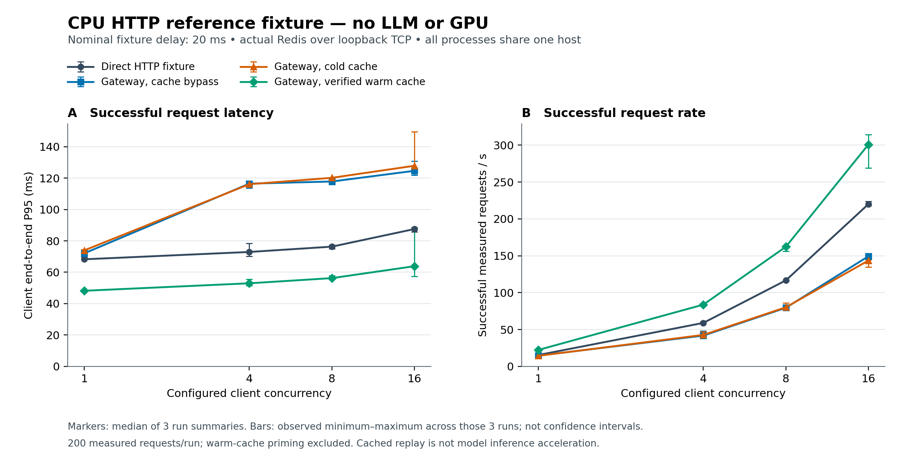

# LLM Serving Gateway

A Python research prototype for routing requests to an OpenAI-compatible model
server or hosted API, with Redis response caching and bounded dependency I/O.
The repository pairs serving code with a matched-workload benchmark and
controlled failure checks.

The CPU reference experiment measures gateway/cache behavior against an HTTP
fixture. Real LLM inference, GPU throughput, model TTFT and quantization quality
remain unmeasured. See [results](benchmarks/RESULTS.md), the
[measurement protocol](benchmarks/PROTOCOL.md) and [raw runs](benchmarks/runs/).



The [interview practice notes](docs/INTERVIEW_NOTES.md) connect the implementation
to its evidence and give exercises for explaining the tradeoffs.

## Reproduce the checks

Python 3.12; the CPU reference stack was validated on Linux. The pinned benchmark
requirements include an embedded Redis executable for an isolated local run.

```bash
python3.12 -m venv .venv
source .venv/bin/activate
pip install -r requirements-benchmark.txt
python -m pytest
```

See [START_HERE.md](START_HERE.md) for the reference-stack command and a real
model connection. No hosted API key or GPU is needed for the reference checks.

## Serving interface

```json
{
  "messages": [{"role": "user", "content": "Explain KV caching briefly."}],
  "max_tokens": 128,
  "temperature": 0,
  "seed": 0,
  "use_cache": true
}
```

Send this body to `POST /v1/chat`. The response contains `content`, `backend`,
`model`, `cached`, `latency_ms` and `app_version`. This endpoint returns complete
JSON. It does not stream, so its server-side elapsed time is not TTFT.

`GET /health` checks process liveness. `GET /ready` returns 200 only if the
configured model is advertised by the authenticated backend models endpoint;
otherwise it returns 503. Readiness checks are excluded from load measurements.

## Cache and failures

Cache keys include backend name/endpoint, model, declared revision/dtype,
messages, generation controls and an optional `X-Cache-Namespace` header.
Revision/dtype values come from operator configuration. A deployment must change
these labels or namespace when changing the underlying weights/configuration.
The namespace supports isolated benchmark runs; it does not authenticate tenants
or authorize access.

Corrupt cache values become misses. Redis reads and writes each have a bounded
I/O budget and fail open. Upstream transport/timeouts return 503; malformed JSON
or invalid completion content returns 502 before anything is cached. Persistent
HTTP connections are reused and closed during application shutdown.

## Configuration

| Variable | Default / purpose |
| --- | --- |
| `LLM_BACKEND` | `selfhosted` or `hosted` |
| `VLLM_URL` | `http://localhost:8001/v1` outside Docker |
| `VLLM_MODEL` | `Qwen/Qwen2.5-1.5B-Instruct` |
| `HOSTED_URL`, `HOSTED_MODEL` | Hosted OpenAI-compatible endpoint/model |
| `HOSTED_API_KEY` | Hosted credential, supplied outside source control |
| `REDIS_URL` | `redis://localhost:6379/0` |
| `CACHE_TTL` | 3600 seconds |
| `CACHE_TIMEOUT` | 0.25 seconds per Redis operation |
| `REQUEST_TIMEOUT` | 60 seconds for a backend request |
| `READINESS_TIMEOUT` | 5 seconds |
| `MODEL_REVISION`, `INFERENCE_DTYPE` | `unspecified`; operator cache labels |

Docker Compose now forwards the selected backend and hosted/self-hosted settings
from the environment. Its gateway port is bound to loopback and Redis has no
published host port. A Docker gateway needs a model endpoint reachable from the
container; use a private endpoint or tunnel appropriate to that environment.

## Measurements and limitations

The runner keeps direct JSON, gateway bypass, cold response cache and verified
warm response cache separate. It preserves prompts and generation controls,
records failures/retries/queue delay, and writes raw JSONL plus summary JSON.
Warm replay must match the primed answer; unexpected cache behavior invalidates
that run. A separate direct-stream mode can measure SSE TTFT on an actual server.

This prototype has no authentication, rate limiting, per-tenant authorization,
production traffic or uptime history. Cache TTL/isolation checks and local fault
checks do not establish production security or availability. No multi-node,
streaming gateway, real-model compression or GPU acceleration result is claimed.
Public or production deployment requires additional engineering and review.

