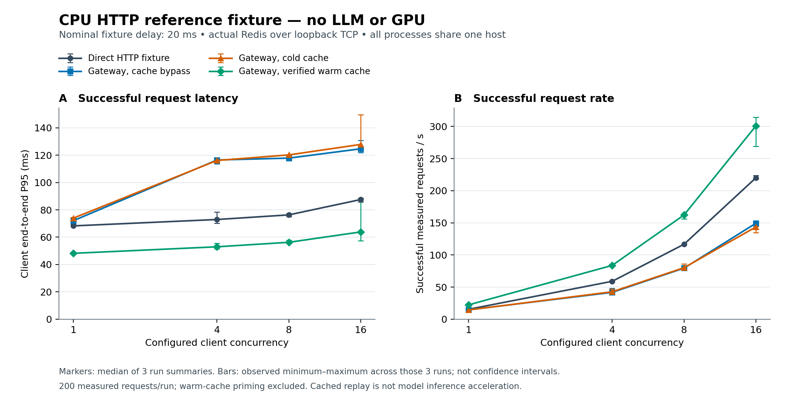

# Gateway benchmark results

<!-- Generated by benchmarks/generate_report.py from preserved run evidence. -->

**Measured 2026-11-10: CPU HTTP fixture integration, not LLM or GPU performance.**
The preserved matrix contains **48 runs and 9,600 measured requests**, with **0 failed measured requests**. Another **2,400 successful warm-cache priming requests** are excluded from measured latency and throughput. The 4 controlled fault checks below are separate from this matrix.

The upstream is a deterministic SHA-256 text sentinel with a nominal 20 ms asynchronous delay. It has no tokenizer, trained model, vLLM engine, or GPU. Its content checks establish protocol consistency, not language-model accuracy.



Markers show the median of three per-run summaries; error bars span the **observed minimum–maximum of those three runs, not a confidence interval**. All services and the client share one host.

## Method and environment

- The same 200 unique fixed payloads, generation parameters, and order were used across four separately measured paths, at client concurrency 1, 4, 8, and 16.
- Three repetitions were collected per path/concurrency. Path order rotated within each repetition/concurrency block; the runs were sequential.
- Retries were disabled. This is a bounded-concurrency closed-loop workload, not an open-loop arrival-rate or sustained production-load study.
- Service/HTTP warm-up was separate from response-cache priming. Health and readiness checks were outside the measured request matrix.
- Cold-cache runs used fresh namespaces and distinct fixed payloads; measured responses were cache misses. Warm runs primed the same payloads, then required cache hits with content identical to the primed answers.
- Client end-to-end latency includes HTTP, connection/pool, decoding, and scheduling effects. Percentiles use linear interpolation. Reported group values are medians of run summaries, not pooled request percentiles.

| Field | Recorded value |
| --- | --- |
| CPU exposed by host | AMD EPYC 7763 64-Core Processor |
| Logical CPUs visible to process | 9 |
| Platform | Linux-6.18.57-x86_64-with-glibc2.41 |
| Python | 3.12.14 |
| Gateway / fixture workers | 1 / 1 |
| Fixture ID | `cpu-reference-fixture-v1` |
| Nominal fixture delay | 20 ms; not an observed service-time guarantee |
| Redis server | 6.2.14; standalone, 64-bit, loopback TCP |
| Redis client protocol | RESP3 via redis-py defaults; loopback TCP; actual bundled Redis server |
| Client placement | Same shared host as gateway, fixture and Redis; loopback HTTP |
| CPU / memory quota metadata | cgroup limits unavailable in recorded environment |
| Full experiment wall time | 410.39 s; includes priming, controls and fault checks, not a throughput denominator |

Recorded measurement dependencies: `fastapi==0.141.1`, `httpx==0.28.1`, `redis==8.1.0`, `redislite==6.2.912183`, `uvicorn==0.52.1`. Figure generated with `matplotlib==3.10.8`.

## All path/concurrency results

Every row summarizes three runs × 200 measured requests = 600 measured requests. Brackets contain the minimum and maximum **per-run** result. Successful request rate is successful measured requests divided by that run's measured elapsed time; priming is excluded.

| Client C | Path | Median run P50 (ms) | Median run P95 [min–max] (ms) | Median successful req/s [min–max] | Failed / measured | Cache hits / measured |
| ---: | --- | ---: | ---: | ---: | ---: | ---: |
| 1 | `direct-json` | 64.14 | 68.26 [68.18–69.59] | 15.41 [15.21–15.45] | 0 / 600 | 0 / 600 |
| 4 | `direct-json` | 67.93 | 72.93 [70.15–78.39] | 58.97 [57.59–60.67] | 0 / 600 | 0 / 600 |
| 8 | `direct-json` | 68.16 | 76.31 [75.02–77.27] | 116.66 [116.50–116.77] | 0 / 600 | 0 / 600 |
| 16 | `direct-json` | 69.02 | 87.53 [85.71–88.48] | 220.04 [218.15–223.73] | 0 / 600 | 0 / 600 |
| 1 | `gateway-bypass` | 68.02 | 72.04 [72.04–72.18] | 14.57 [14.56–14.59] | 0 / 600 | 0 / 600 |
| 4 | `gateway-bypass` | 110.92 | 116.46 [113.56–117.84] | 41.76 [40.72–48.15] | 0 / 600 | 0 / 600 |
| 8 | `gateway-bypass` | 111.75 | 117.83 [117.66–119.75] | 79.48 [79.13–80.52] | 0 / 600 | 0 / 600 |
| 16 | `gateway-bypass` | 112.24 | 124.65 [121.79–130.79] | 149.33 [149.14–151.09] | 0 / 600 | 0 / 600 |
| 1 | `gateway-cold` | 68.13 | 73.92 [73.18–74.59] | 14.34 [14.26–14.41] | 0 / 600 | 0 / 600 |
| 4 | `gateway-cold` | 107.99 | 116.11 [115.92–116.16] | 42.70 [41.50–47.10] | 0 / 600 | 0 / 600 |
| 8 | `gateway-cold` | 111.75 | 120.18 [120.03–120.26] | 80.14 [77.82–85.82] | 0 / 600 | 0 / 600 |
| 16 | `gateway-cold` | 114.66 | 127.85 [126.41–149.60] | 143.57 [134.88–144.66] | 0 / 600 | 0 / 600 |
| 1 | `gateway-warm` | 44.04 | 48.19 [47.97–48.54] | 22.29 [22.16–22.44] | 0 / 600 | 600 / 600 |
| 4 | `gateway-warm` | 47.83 | 52.96 [51.37–55.49] | 83.73 [82.09–85.63] | 0 / 600 | 600 / 600 |
| 8 | `gateway-warm` | 48.96 | 56.26 [55.79–57.81] | 162.24 [156.24–162.73] | 0 / 600 | 600 / 600 |
| 16 | `gateway-warm` | 49.26 | 63.83 [57.41–88.53] | 300.85 [269.13–314.11] | 0 / 600 | 600 / 600 |

At concurrency 16, verified warm replay had median run P95 **63.83 ms** (run range 57.41–88.53), and median successful request rate **300.85 req/s**. The cold-cache path had median run P95 **127.85 ms**. These are observations from different sequential runs on one shared CPU host. They are not a production SLO, an isolated estimate of gateway overhead, or evidence of faster model inference.

All 2,400 measured warm responses were verified cache hits. For each warm run the fixture counter recorded 200 calls during priming and no additional calls during measured replay; non-warm runs recorded 200 calls during measurement. The report validates those counters and cross-path content sentinels against the preserved request files.

## Separate controlled fault checks

| Fault / operation | Expected HTTP | Observed HTTP | Liveness HTTP | Recorded interval (ms) | Outcome |
| --- | ---: | ---: | --- | ---: | --- |
| non-json | 502 | 502 | 200 | 72.21 | pass |
| timeout | 503 | 503 | 200 | 842.26 | pass |
| unhealthy | 503 | 503 | 200 | 50.39 | pass |
| Redis server stopped | 200 | 200 | not recorded | 29.61 | pass; cached=false |

The unhealthy-backend check called readiness; non-JSON and timeout checks called the chat route. Their recorded intervals include the following liveness request in the archived driver. The Redis-down interval covers the chat request, which succeeded uncached. These four one-off intervals are not latency percentiles or strict deadline guarantees. Expected fault responses are excluded from the normal-workload failure count.

## Provenance and regeneration

- [Environment and source hashes](runs/cpu-reference-20261110/environment.json), [completion totals](runs/cpu-reference-20261110/completion.json), [archived aggregate](runs/cpu-reference-20261110/aggregate.json), [fault evidence](runs/cpu-reference-20261110/fault_smoke.json).
- [Full raw-data archive](evidence/cpu-reference-20261110.tar.gz) includes request JSONL, logs, summaries, metadata, and the measured source snapshot. The repository retains summaries and provenance unpacked; extract the archive before regenerating from a fresh clone. Verify its checksum against the [SHA256SUMS](evidence/SHA256SUMS) before extraction.
- Extracted per-request evidence is in `runs/cpu-reference-20261110/r*.jsonl`; each run has a matching `.summary.json`. Raw records distinguish `prime` and `measure`.
- Upstream source base: `69b66f63fc8d91afc3e6056b79c27b8a3de7942f`. The measurements include working-tree changes; that upstream commit alone does not identify the measured implementation.
- [Exact measured source snapshot](runs/cpu-reference-20261110/source_snapshot/) contains the eight source/workload files whose SHA-256 hashes are recorded in the environment. The generator validates those archived bytes before producing this report.
- Shared workload SHA-256: `0d44c7c5ce4307e9ad012ac5c513a769a0606981bf8878e070ee3abc1d7fda79`.
- Later generic-runner validation fixes are not part of this full matrix. The matrix used JSON responses, zero retries, role/content-only messages, and an independent driver check rejecting pre-existing priming hits. Attribute these numbers to the archived snapshot, not to the latest source. A later smoke run is separate evidence and does not replace this 48-run matrix.
- Final source smoke validation: [current-code completion](runs/final-smoke-20261110/completion.json) and [clean pinned-environment completion](runs/locked-env-smoke-20261110/completion.json) each record 8 runs, 32 measured requests, zero failures and four passed fault checks. Their raw archives are in [evidence/](evidence/); they are excluded from the matrix above.
- Metadata correction: the archived driver originally labeled Redis as RESP2. After measurement, both installed synchronous and asynchronous redis-py connection defaults were inspected and found to use protocol 3. The environment now records RESP3 and an explicit correction note. Raw requests and measured source hashes were not changed by that correction.
- [Initial transport attempt](runs/cpu-reference-20261110/initial_transport_attempt.json): a private Unix socket was unavailable and produced no matrix measurements. The reported matrix used an actual bundled Redis server over normal loopback TCP. The separate quick validation recorded there is not counted in the 48 runs.

From the repository root, extract the raw-data archive if the request JSONL files are not already present, then regenerate without rerunning services:

```bash
mkdir -p benchmarks/runs
tar -xzf benchmarks/evidence/cpu-reference-20261110.tar.gz -C benchmarks/runs
python benchmarks/generate_report.py --run-dir benchmarks/runs/cpu-reference-20261110
```

To reproduce measurement, use the archived source files in a separate checkout and the recorded environment versions. Do not overwrite the preserved evidence. Running the current driver produces a new experiment with new provenance.

## Limits and work not run

- **Real model / GPU / vLLM benchmark: NOT RUN.** No model tokens/s, TTFT, TPOT, GPU utilization, precision comparison, or model speedup is reported.
- **Held-out language-model quality and calibration: NOT RUN.** The deterministic sentinel checks protocol correctness only; they do not measure task accuracy, calibration, safety, reward quality, or semantic equivalence.
- Nominal backend sleep is 20 ms; actual E2E includes other work and scheduling. No claim that observed latency should equal 20 ms follows.
- Three short repetitions with 200 measured requests each have limited tail support. The bars show observed variation, not statistical confidence or independence across repeated requests.
- Client, gateway, fixture, and Redis contend on the same shared host. Client loop-lag telemetry is preserved in run summaries but cannot isolate the causes of the observed latency or establish a remote-client result.
- No traffic from real users, production uptime, sustained soak test, multi-node result, or production service-level guarantee is established.
- A response-cache hit replays an existing answer. It is distinct from model warm-up, KV/prefix caching, and faster token generation.

See [measurement protocol](PROTOCOL.md) and [interview practice notes](../docs/INTERVIEW_NOTES.md) for scope and next experiments.
